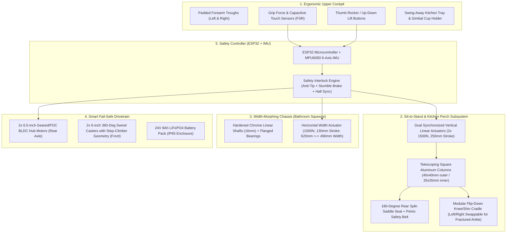
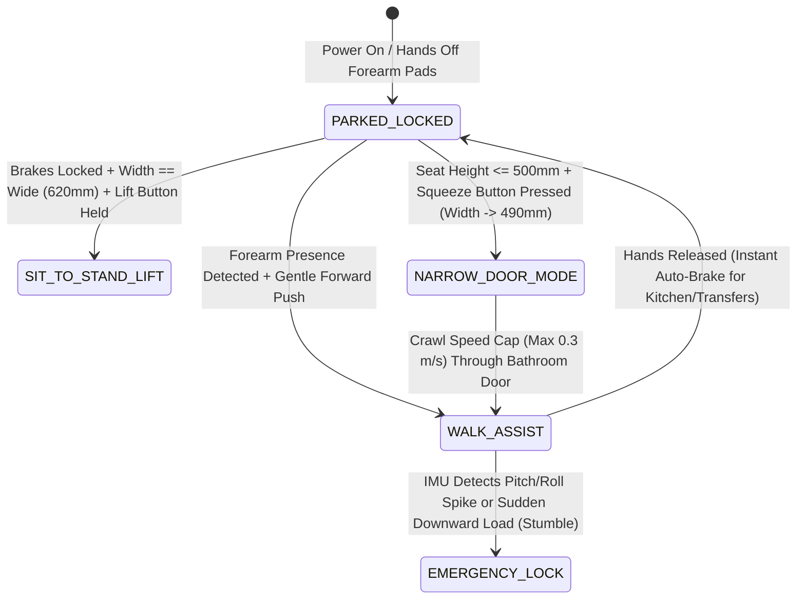

# FreeStep v2 ("ElderStep Pro"): Engineering Teardown, Master Plan & Product Roadmap

## 1. Mission & Core Design Philosophy

We are solving two interconnected goals:
1. **Immediate Clinical Use Case (Post-Surgical Elderly Recovery):** An elderly user recovering from **ankle fracture surgery** who alternates between a **wheelchair** and a **standard walker** (for short durations), and faces two major daily bottlenecks:
   * **Getting into and out of the bathroom** (narrow `20"–21"` residential bathroom doorways, doorway threshold lips, tight internal turning space, wet floors, and low toilet sit-to-stand transitions).
   * **Using the kitchen independently** (standing at a `32"–34"` kitchen slab/`ota` causes rapid ankle swelling and requires both hands on a normal walker, leaving zero hands free to chop, cook, or carry hot tea/food).
2. **Product Innovation Goal:** Engineer a **next-generation Sit-to-Stand Smart Mobility & Rehabilitation Walker** tailored for Indian homes (`₹18,000–₹27,000` BOM) that outperforms both the viral DIY project ([`README.md`](README.md)) and `₹90,000–₹3,50,000` commercial machines (*NeoStand*, *The Zeen*, *Camino Smart Walker*, *4-in-1 Lift Chairs*).

---

## 2. Engineering Teardown of Original `htx-studio/FreeStep`

We analyzed both the 106-item Bill of Materials ([`README.md`](README.md)) and the 59.5 MB CAD assembly ([`Models/FreeStep.step`](Models/FreeStep.step)).

| Open / Standing State | Closed / Collapsed State |
| :---: | :---: |
|  |  |

### 2.1 How the Original `FreeStep` Works (From CAD Inspection)
* **Top Frame (`Upper_Crossbar_Assy`):** A single CNC-bent `6061` aluminum U-tube (`3.5 mm` wall thickness) with two rear-pointing ABS handles (`Handle_Grip`) and two curved under-arm hooks.
* **Vertical Folding Mechanism (Pantograph Diamond Linkage):**
  * Each side uses four `ø15 mm × 560 mm` carbon fiber tubes (`Carbon_Tube_Dia_15_560`) arranged in a front and rear diamond/rhombus linkage pinned with `M6/M8` shoulder bolts (`Hex_Socket-Shoulder_Bolt`).
  * Two `SXTL (200 mm stroke)` linear actuators push diagonally from the front-bottom wheel block against the rear linkage crossbar.
  * To keep the top handrail level while rising, the upper and lower ends of the diamond arms slide along six `ø10 mm × 520 mm` carbon fiber rods (`Carbon_Tube_10_520`) using eight `LM10UU` steel linear ball bearings (`Linear_Bearing_Block_Upper` and `Lower_Slider`), synchronized front-to-back by two `3M-1188` timing belts and four `25-tooth` pulleys (`3M_Timing_Pulley-25`).
* **Drivetrain & Steering:**
  * **Rear Drive:** Four `7-inch` rubber wheels (dual-wheel bogie per side) driven by two `12V 550` brushed DC toy gearboxes (`12v550_Motor_Gearbox`).
  * **Front Steering:** Two `6-inch` front wheels, each steered actively via a `Feetech ST-3032` serial bus servo (`30 kg·cm` stall torque) meshing a pinion (`Pinion_Gear`) with a carbon-fiber spur gear (`Large_Spur_Gear`).

### 2.2 The 7 Critical Engineering Flaws in `FreeStep` (Why We Redesign It)

> [!CAUTION]
> **Do not build the original `FreeStep` as-is for an elderly post-op patient.** Inspecting [`Models/FreeStep.step`](Models/FreeStep.step) reveals 7 severe structural and ergonomic failure points when used by a senior with an ankle fracture.

| # | Subsystem in `FreeStep` | Failure Mode Found in CAD / BOM | How We Fix It in **ElderStep Pro (v2)** |
| :- | :--- | :--- | :--- |
| **1** | **Actuators only lift the handlebar (`Upper_Crossbar_Bent_Tube`), NOT a seat** | If an elderly person is sitting on a bed or toilet, a rising handlebar forces them to pull their entire body weight up using only their wrists and shoulders. Also offers **zero hip support** at the kitchen counter. | Couple the vertical lift directly to a **180° Split-Saddle Sit-to-Stand Seat + Forearm Troughs** so the actuators physically lift **under the pelvis/hips** (from `17"` to `28"`). |
| **2** | **`LM10UU` steel ball bearings running on `ø10 mm` hollow carbon tubes** | Hardened steel balls inside `LM10UU` bearings point-load and crush the epoxy resin surface of hollow `ø10 mm` carbon fiber tubes (`2 mm` wall), causing delaminating grit and sudden binding under human weight. | Replace with **industrial telescoping square aluminum/steel columns with Delrin/PTFE wear pads** or **hardened chrome-plated steel linear shafts (`SFC16`)**. |
| **3** | **Slender `ø15 mm` carbon tubes drilled with 5 cross-holes (`Carbon_Tube_Dia_15_560_5Hole`)** | Drilling `6 mm–8 mm` cross-holes through a `15 mm` carbon tube removes >40% of its cross-section and destroys fiber continuity. If the user leans sideways while offloading a fractured ankle, the tube snaps in shear at the middle pin. | Eliminate thin cross-drilled carbon scissor rods. Use **vertical telescoping columns** or **heavy-wall 6061-T6 aluminum box links with pressed flanged bearings**. |
| **4** | **Multi-part glued ABS 3D prints in primary load path (`Lower_Crossbar_Rear`)** | `Lower_Crossbar_Rear` is split into 4 separate ABS pieces printed and glued together. Layer-line delamination at the rear axle will cause catastrophic frame collapse. | **Zero 3D printing in structural joints.** Use **laser-cut `4 mm–6 mm` steel/aluminum gusset plates** + standard metal tubes. Use 3D printing *only* for ergonomic covers, sensor mounts, and grips. |
| **5** | **`12V 550` brushed toy gearboxes on rear wheels** | Ride-on toy `550` plastic gearboxes are non-backdrivable (wheels lock/drag if pushed manually without power), noisy, jerky, and strip their nylon teeth under sudden braking loads. | Use **6.5" or 8" Brushless (BLDC) Geared/Direct Hub Motors** with Hall sensors + FOC controller: 100% silent, smoothly backdrivable when unpowered, and capable of **instant electromagnetic holding brakes**. |
| **6** | **Front wheels locked to `ST-3032` hobby servos (`30 kg·cm`)** | Front wheels cannot caster freely! Every turn requires the servo to fight floor friction. When an elderly user leans 40 kg on the front frame on tile, the servo stalls and strips its gears, leaving the walker unable to turn in a tight bathroom. | Use **heavy-duty 360° ball-bearing swivel casters** in front (with optional directional lock), and handle steering via **differential torque on the rear BLDC hub motors**. |
| **7** | **Low-slung electronics box (`Electronics_Enclosure`) on bottom rear axle** | Positioned ~12 cm off the floor (`Carbon_Tube_Dia_30_555`). In an Indian wet bathroom, water splashes directly into the battery and motor drivers. | Mount an **IP65 waterproof electronics & LiFePO4 battery module under the upper frame / seat support**, keeping only IP66-sealed hub motors and actuators down low. |

---

## 3. What to Solve & How to Solve It (Problem $\rightarrow$ Solution Matrix)

| Daily Scenario & Bottleneck | Root Biomechanical / Environmental Cause | Our Engineering Solution |
| :--- | :--- | :--- |
| **1. Walking without overloading the healing ankle** | Normal walkers put all offloaded weight onto the wrists and force hunching; after 5 minutes, arms tire out. | **Padded Forearm Gutter Troughs + Pelvic Partial-Weight-Bearing Saddle:** Shifts offloading from weak wrists to strong forearms/elbows and supports 30%–60% of body weight under the pelvis while walking upright. |
| **2. Standing at the kitchen slab (`ota`) to cook or wash dishes** | Standing still pools blood in the fractured ankle (throbbing edema), and holding a walker occupies both hands. | **27"–28" "Kitchen Perch Mode" + Flip-Down Knee Cradle:** The actuators raise the split saddle to counter height (`27"`) and lock the wheels solid. Plus, a padded **Knee/Shin Cradle** flips down on the injured side to float the healing ankle completely off the floor while **both hands are 100% free** to cook. |
| **3. Carrying hot chai, plates, or bowls from kitchen to room** | Impossible to carry dishes while gripping walker handles; open cups spill when wheels hit tile joints. | **Swiveling Self-Leveling / Silicone-Lined Kitchen Tray + Side Cup Gimbal:** A swing-out tray mounted to the front crossbar with a recessed rim and spill-proof mug holder. |
| **4. Getting through narrow Indian bathroom doors (`20"–21"` clear width)** | Standard walkers/wheelchairs (`24"–26"`) need a wide base for stability, so they jam at Indian bathroom doorframes. | **Motorized "Bathroom Squeeze" Width-Morphing Crossbar:** Shrinks total frame width from **620 mm (`24.4"`)** down to **490 mm (`19.3"`)** via a synchronized horizontal linear actuator so the user glides straight through the doorway. |
| **5. Crossing the `15 mm–30 mm` bathroom doorway threshold lip** | Small caster wheels slam into the marble water-stopper lip; lifting a walker on one foot causes backward falls. | **Larger 6"–7" Front Casters + "Threshold Climb" Torque Boost + Beveled Rubber Bridge:** Front wheels roll over lips easily while rear BLDC hub motors provide a slow, high-torque crawl assist. |
| **6. Getting onto & off the toilet or low bed on one good leg** | Pushing up from a 16" toilet or bed with only one healthy leg requires 2x normal quadriceps force. | **Motorized Sit-to-Stand Split Saddle (`17"` $\rightarrow$ `27"`):** Frame backs directly over the Western toilet or up to the bed edge. The 180° split seat latches under the hips at `17"` and smoothly lifts the user to standing height (`26"–27"`) at the press of a button. |
| **7. Walker rolling away during transfers or stumbling** | Seniors forget to pull manual loop brakes before sitting/standing, causing the walker to shoot out from under them. | **Fail-Safe "Dead-Man's" Auto-Braking Hub Motors:** Capacitive/FSR grip sensors in the forearm pads keep the rear wheels **electromagnetically locked (`0 RPM`) by default**. Wheels only release when forearms are properly seated and gently pushing. |

---

## 4. Mechanical & Electrical Architecture ("ElderStep Pro")

### 4.1 Key Mechanical Innovations Explained

#### A. The 180° Split-Saddle Sit-to-Stand & Kitchen Perch
* **Why a Split Saddle is Essential:** If you put a fixed seat inside a walker, the user cannot walk because the seat hits their thighs.
* **How It Works:**
  * The walker has an **open rear entry** with two padded, contoured half-seats (`Left Wing` and `Right Wing`) mounted on heavy-duty vertical hinge pins attached to the lifting columns.
  * **Walking Mode:** Both saddle wings swing outward $90^\circ$ flush against the side frames, giving completely unobstructed leg room to walk.
  * **Sit-to-Stand / Kitchen Perch / Wheelchair Mode:** While standing or sitting on the bed/toilet, the two wings swing inward behind the hips and lock together with a self-latching plunger pin.
  * **Over-the-Toilet Compatibility:** A removable central commode cutout in the two saddle wings allows the frame to roll **directly over a standard Western toilet**—turning the walker itself into a motorized toilet-lift frame.

#### B. Dual-Stage Vertical Lift Columns (Replacing `FreeStep`'s Fragile Carbon Scissor)
* Instead of `FreeStep`'s 4-bar carbon-fiber diamond linkage (which shifts forward/backward as it rises and requires timing belts), we use **two vertical telescoping aluminum columns** (`40×40 mm` outer anodised 6061 tube sliding over a `35×35 mm` inner tube lined with low-friction `UHMW-PE / Delrin` wear strips).
* Inside or parallel to each column is a **24V `1500N` (150 kgf) IP65 Linear Actuator with Hall-Effect Pulses (`250 mm` stroke)**.
* **Height Range:**
  * **Lowest Position (`430 mm / 17"` seat height; `760 mm / 30"` forearm height):** Matches Indian beds, sofas, and Western toilets for effortless seated transfers.
  * **Highest Position (`680 mm / 26.8"` seat height; `1010 mm / 39.8"` forearm height):** Lifts the user's hips to full standing/perching posture at a standard `32"–34"` Indian kitchen granite counter (`ota`).

#### C. Modular "Ankle-Saver" Knee & Shin Offload Cradle
* A padded orthopedic trough (`220 mm` long × `110 mm` wide, memory foam + wipeable medical vinyl) mounts via a quick-release pin to either the **Left** or **Right** vertical column at knee height (`450 mm` above ground).
* When standing at the kitchen sink or bathroom mirror, the user flips the cradle down $90^\circ$ and rests the injured shin/knee on it. The fractured ankle hangs freely behind the pad with **0% weight bearing** while the good leg and pelvic saddle keep the user rock-steady.

#### D. Fail-Safe State Machine & Anti-Tip Interlocks (ESP32 Firmware)

---

## 5. India Bill of Materials (BOM) & Cost Estimate

All components below are standard off-the-shelf industrial parts available in India via **Robu.in**, **IndiaMART**, **Misumi India**, and local laser-cutting/welding shops.

| Category | Component Description | Qty | Source in India | Est. Cost (INR) |
| :--- | :--- | :-: | :--- | ---: |
| **Vertical Lift** | 24V Heavy-Duty Linear Actuator (`1500N` load, `250mm` stroke, IP65, Hall sensor feedback) | 2 | Robu.in / IndiaMART | ₹5,200 |
| **Width Morph** | 24V Compact Linear Actuator (`1000N` load, `130mm` stroke) | 1 | Robu.in | ₹1,900 |
| **Linear Guides** | `16mm` Hardened Chrome Linear Shafts (`650mm` × 2) + `LMF16LUU` Flanged Bearings (for width morph) | 1 set | Robu.in / Local CNC | ₹1,800 |
| **Chassis Tubes** | Telescoping 6061 Aluminum / SS304 Square Tubes (`40×40mm` & `35×35mm`) + UHMW-PE wear strips | 1 set | Local Metal Market / IndiaMART | ₹2,800 |
| **Laser-Cut Brackets** | `4mm` & `6mm` Laser-Cut Mild Steel / 6061 Aluminum Gussets & Split-Saddle Hinges (Powder-Coated) | 12 pcs | Robu Laser Cutting / Local Fab | ₹2,200 |
| **Rear Drive & Brake** | `6.5"` Geared/Direct BLDC Hub Motor Wheels (24V, high torque, electromagnetic brake capable) | 2 | IndiaMART / E-Bike Hub Suppliers | ₹3,600 |
| **Front Casters** | `6"` Heavy-Duty Medical PU 360° Swivel Casters (Sealed bearings) | 2 | Kosmochem / IndiaMART | ₹1,100 |
| **Electronics & Brain** | `ESP32-S3` DevKit + `MPU6050` IMU + Dual BLDC FOC Driver (`ZS-X11H` × 2) + `BTS7960` Actuator Drivers (× 3) | 1 set | Robu.in | ₹2,400 |
| **Sensors & Controls** | 2x Forearm Force-Sensing Resistors (FSR) + Waterproof Up/Down/Width Rocker Switches + Limit Switches | 1 set | Robu.in | ₹950 |
| **Power System** | `24V 6Ah–8Ah LiFePO4` Battery Pack with BMS + 24V Charger + Emergency Stop Mushroom Button | 1 set | Robu.in / Local EV Pack Builder | ₹3,200 |
| **Ergonomics** | Padded Forearm Gutter Troughs + 180° Split Saddle Cushions + Flip-Down Ankle-Offload Knee Pad + Tray | 1 set | Local Upholstery / Medical Supply | ₹1,800 |
| **3D Printed Parts** | Non-structural ABS/PETG Electronics Covers, Wire Channels, & Ergonomic Handle Grips | ~600g | Self / Robu 3D Printing | ₹650 |
| **Total BOM (Standard Spec)** | **Complete Functional Prototype (Al/Steel Spec)** | | | **~₹27,600** |

---

### 5.1 The "No-Compromise Ultra-Light Medical Spec" (`11.0 kg` Total Weight, Aerospace/Hospital Grade)

When the priority is **minimum weight (`11.0 kg` total vs. `20+ kg` steel frames), whisper-quiet medical operation (`<42 dB`), zero flex, and maximum daily usefulness**, we upgrade the architecture to the **Carbon / `7075-T6` / `igus®` / `LINAK` / `FOC` Specification** (full line-by-line sourcing and mass budget in [`hardware/INDIA_BOM_SOURCING.csv`](hardware/INDIA_BOM_SOURCING.csv)):

| Subsystem | Standard DIY Spec (`~19 kg`) | **No-Compromise Ultra-Light Spec (`11.0 kg`)** | Why It Is Massively Better |
| :--- | :--- | :--- | :--- |
| **Chassis & Columns** | Heavy `40×40 mm` metal box tubes (`~6.5 kg`) | **Autoclave 3K Roll-Wrapped Carbon Tubes (`ø30 mm × 2.5 mm`) + 5-Axis CNC `7075-T6` Billet Split-Clamps + Grade-5 Titanium Bolts (`2.4 kg`)** | Uses outer-diameter CNC clamping + `3M DP420` structural epoxy (zero cross-drilled holes in carbon!). **63% lighter** with aerospace torsional stiffness. |
| **Linear Guides** | Steel rods + `LM16UU` ball bearings (`1.8 kg`, rusts in wet bathrooms) | **`igus® DryLin® W` Hard-Anodized Aluminum Rails + `iglidur® J` Polymer Carriages (`0.9 kg`, igus India Bengaluru)** | **50% lighter**, 100% washdown-proof in wet Indian bathrooms, dead silent, and never binds or gouges under moment loads. |
| **Sit-to-Stand Actuators** | Generic industrial lead-screw actuators (`65 dB` whine, `7 mm/s` slow) | **Medical-Grade `LINAK LA23` or `TiMOTION TA16` (`<42 dB` whisper-quiet, `IPX6` washable, `25 mm/s` fast lift)** | Lifts from `17"` toilet/bed height to `27"` kitchen counter perch in **8 seconds** smoothly and silently; certified for hospital shower chairs. |
| **Rear Hub Drivetrain** | Heavy e-bike iron hub motors (`6.0 kg` pair, cogging drag when off) | **Lightweight Pancake Outrunner FOC Hub Motors (`1.5 kg` pair) + `14-Bit AS5048A` Encoders + `SimpleFOC / VESC`** | Saves **4.5 kg** at the rear axle! Zero magnetic drag when pushed unpowered, plus active tremor damping and instant hill-hold. |
| **Front Casters** | Generic hardware-store swivel wheels | **`Tente®` / `Blickle®` `150 mm` Medical Twin-Wheel Casters with Electromagnetic Straight-Line Lock (`0.6 kg`)** | Effortless rolling over `20 mm` bathroom marble thresholds; locks straight (`0°`) when backing out of narrow bathrooms. |
| **Cockpit Force Sensing** | Film `FSR402` strips (`±15%` drift) | **Dual `20 kg` Aluminum Strain-Gauge Load Cells + `24-Bit ADS1220` ADC inside Forearm Rests** | Measures exact gram-level push intent ("Zero-Gravity" power steering) AND exact kilogram offloading on the healing ankle. |
| **Seat & Kitchen Bridge** | Basic foam pad & clip-on plastic tray | **Viscoelastic Medical Gel Split-Saddle (`Fidlock®` magnetic 1-finger latch) + Elevating Countertop Slide-Bridge Tray (`17"` to `34"`) with Gimbal & `Qi2` Charger** | Tray rises flush with the `33"` kitchen granite counter so she can **slide** heavy pots/plates across without lifting a single gram! |
| **Battery System** | Hardwired `24V` brick (`3.2 kg`) | **`600 g` Hot-Swappable `21700` Lithium Cartridge with `100W USB-C PD` Charging** | Swaps in 3 seconds like a cordless drill battery; charges with a standard laptop USB-C charger. |

---

## 6. Phased Execution & Iteration Plan

### Phase 0 (Days 1–3): Immediate Grandma Relief + Baseline Measurements
* **Action 1:** Get a basic commercial walker/transfer chair immediately AND take **4 exact measurements** in the home:
  1. Clear width of the narrowest bathroom doorway (in `mm` or `inches`).
  2. Height of the bathroom doorway threshold/step lip (`mm`).
  3. Height of the kitchen counter slab (`ota`) from the floor (`mm`).
  4. User's elbow height (standing) and knee-to-floor height (`mm`).
* **Action 2:** Add two zero-wait upgrades to the current setup: a **clip-on kitchen walker tray** and a **beveled rubber threshold ramp** at the bathroom door.

### Phase 1 (Weeks 1–2): "ElderStep v1.0" — Sit-to-Stand + Kitchen Perch + Ankle Cradle
* **Focus:** Solve the **vertical lifting** and **hands-free kitchen/toilet support** first (fixed width calibrated to fit the bathroom door).
* **Build Steps:**
  1. Fabricate the U-frame base (calibrated to `19.5"`–`20.5"` width to clear the specific bathroom door without needing the horizontal morphing actuator yet) with two vertical telescoping columns and the `1500N` linear actuators.
  2. Mount the **180° Rear Split-Saddle Seat**, **Forearm Troughs**, and **Flip-Down Ankle-Offload Knee Cradle**.
  3. Wire the **Synchronized Dual-Actuator Controller** (using Hall-sensor feedback so left and right columns never rack or tilt).
* **Test Milestone:** Sit on the split saddle at bed/toilet height (`17"`), press UP to stand effortlessly, walk into the kitchen, raise the saddle to `27"` counter height, rest the injured leg on the knee cradle, and prepare tea with **both hands completely free**.

### Phase 2 (Weeks 3–4): "ElderStep v1.5" — Smart Auto-Braking Hub Motors & Threshold Assist
* **Focus:** Replace rear passive wheels with **24V BLDC Hub Motors + Forearm Touch/Force Sensors + IMU**.
* **Build Steps:**
  1. Implement **"Dead-Man's Auto-Brake"** (wheels locked solid whenever hands leave the handles—100% safe when perching at the kitchen stove or sitting down).
  2. Implement **Touch-Proportional Power Assist** (cancels out the weight of the frame so it feels feather-light) + **Threshold Crawl Button** to climb the bathroom doorway lip smoothly.

### Phase 3 (Weeks 5–6): "ElderStep v2.0" — Dynamic Width-Morphing & Smart Guardian Suite
* **Focus:** Add the motorized horizontal telescoping crossbar (`490 mm` $\leftrightarrow$ `620 mm` width morphing) with ESP32 safety interlocks, plus smart health/safety add-ons.

---

## 7. Master Brainstorm: 27+ Ideas to Improve, Iterate & Expand This Product for the Elderly

### A. Biomechanical & Orthopedic Offloading Ideas
1. **Load-Cell Partial-Weight-Bearing (PWB) Coach:** Put load cells under the forearm rests and saddle. When an ankle-fracture surgeon prescribes *"20% partial weight bearing on Week 6"*, an LED bar on the handle glows **Green** when the user puts the right amount of weight on the foot and flashes **Red / vibrates** if overloading the healing bone.
2. **Spring-Loaded Pelvic Suspension Mode:** Allow the vertical actuators or a series elastomer spring to give `2 cm` of cushioned vertical bounce while walking—absorbing heel-strike shock on healing ankle/knee joints.
3. **Motorized Elevating Leg Rest (Wheelchair Mode):** When using the device seated like a wheelchair, a motorized calf rest raises the fractured ankle horizontally to prevent swelling (`dependent edema`).
4. **Forward-Tilt "Natural Stand" Arc:** Instead of lifting purely vertically ($90^\circ$), angle the telescoping columns $8^\circ$ forward so the saddle moves **up and slightly forward**—matching the natural human center-of-mass trajectory when standing up from a chair.
5. **Quick-Swap Orthopedic Modules:** Universal dovetail rail on the vertical pillars that accepts: (a) Ankle Knee-Cradle, (b) Hip-Replacement Abduction Cushion, or (c) Stroke Hemiplegia Arm-Sling Gutter.
6. **Powered Rehabilitation Resistance Mode:** As the ankle heals and needs physiotherapy, the hub motors can apply gentle, programmable rolling resistance to rebuild leg strength safely indoors.

### B. Kitchen & Daily Independence Ideas
7. **2-Axis Self-Leveling Tray for Hot Liquids:** Passive pendulum gimbal (or 2-servo IMU-stabilized mount) for a teacup/soup bowl so even when crossing a bumpy bathroom or kitchen threshold, hot chai never spills.
8. **Slide-Bridge Counter Transfer Top:** The walker tray adjusts vertically via the main lift actuators to match the exact height of the kitchen granite counter (`33"`), allowing the user to **slide** a heavy pot or bowl from the slab onto the walker tray with zero lifting.
9. **Built-In Magnetic Reacher/Grabber Holster:** Integrated mounting dock for a reacher stick right beside the right forearm pad so dropped items are never out of reach.
10. **Under-Tray Silicone Keep-Warm Pad:** A small 24V silicone warming mat built into the walker tray so meals stay warm while moving slowly from the kitchen to the bedroom.
11. **One-Handed Jar/Bottle Clamp on Tray:** A recessed silicone V-grip built into the corner of the walker tray that holds medicine bottles or spice jars steady so they can be opened with one hand while seated.

### C. Bathroom & Transfer Mastery Ideas
12. **Direct Over-Commode Split Saddle:** Hygienic, waterproof PU foam split-seat wings that leave a central opening so the user can roll over a Western toilet, lower the seat to `17"`, and use it directly.
13. **Wall-Docking Laser / Alignment Guide:** Two low-power floor line lasers that project the exact width of the walker onto the floor ahead so the user can immediately see if the walker will clear a doorway or align over the toilet when backing up.
14. **Swivel-Lock Anti-Scissor Front Casters:** Small electromagnetic pin that locks the front swivel casters straight ahead (`0°`) when backing straight out of a narrow bathroom so the front wheels don't flutter into the doorframe.
15. **Self-Drying / Squeegee Wheel Guards:** Soft rubber wiper blades inside the wheel fenders that wipe water off the tires when exiting a wet bathroom so water isn't tracked onto dry bedroom tile.
16. **Warm-Air Foot/Cast Dryer Vent:** A low-wattage fan duct on the lower frame to blow gentle air around a sweaty cast or damp foot after bathroom visits.

### D. Smart Robotics, Safety & Fall-Prevention Ideas
17. **Ultrasonic / ToF Rear Obstacle & Step-Drop Cliff Sensors:** Two downward/rear-facing `VL53L1X` Time-of-Flight sensors at the rear wheels. When backing up toward a step, if the sensor detects a drop-off or obstacle behind the heels, the hub brakes lock automatically.
18. **Automatic "Too-Far-Behind" Distance Limiter:** A front-body ToF distance sensor measures torso distance from the handlebar—if the walker gets $>25\text{ cm}$ ahead of the hips, the hub motors gently slow down until the user catches up.
19. **Zero-Turn "Spin-in-Place" Tank Mode:** Inside a cramped bathroom where walking in a circle is impossible, the user sits on the latched saddle, lifts feet onto fold-down footrests, and uses a joystick to spin $180^\circ$ in place (one rear wheel forward, one backward) to face the door and walk out.
20. **"Summon to Bedside" Remote Control:** A big single-button bedside remote drives the walker slowly over to the side of the bed at `<0.2 m/s`.
21. **Nighttime Path-Projection Headlights + Auto Bed-Exit Wakeup:** Downward-angled warm LED strips under the frame paired with a PIR motion sensor facing the bed—lighting up the floor automatically the moment feet dangle off the bed at night.
22. **Haptic Handlebar Warnings:** Vibration motors inside the left/right handlebar grips that pulse if that side is about to clip a doorframe.

### E. Health Monitoring & Family Peace-of-Mind Ideas
23. **Automatic Daily Rehab Progress Tracker:** Logs daily walking duration, sit-to-stand count, and average weight offloading percentage—sending a daily summary to the family WhatsApp group.
24. **Heart-Rate & SpO2 Sensor in Handle Grip:** Flush `MAX30102` pulse oximeter sensor in the thumb rest to monitor exertion while walking and alert the user to sit down on the saddle before getting fatigued.
25. **One-Tap Voice Intercom / WhatsApp Call Button on Handle:** Built-in `ESP32` speaker/mic button on the handlebar for instant hands-free calling from the kitchen or bathroom.
26. **Pill & Hydration Reminder Chime on Cockpit:** Gentle voice/LED reminder on the handlebar display with a built-in compartment for post-surgery tablets and a water bottle.
27. **Swap-in Power-Tool Battery Architecture:** Use a slide-in **20V/24V power-tool battery cartridge** so a charged spare can be swapped in 3 seconds without plugging the walker into a wall outlet.
