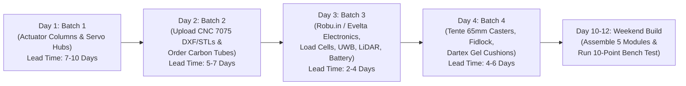

# ElderStep Pro (`10.20 kg` 5-Module Final Spec) — Procurement & Build Execution Plan

This document is your step-by-step master playbook to **procure all components in India within 10 days** and **assemble the complete walker in a single weekend** using the **5 Bolt-Together Modules** architecture.

---

## 1. Final System Summary (`10.20 kg` Total Mass)

* **Total Mass:** **`10.20 kg` (`22.4 lbs`)** — supports users up to **`120 kg`**.
* **Universal Bathroom-Ready Footprint:** Fixed **`495 mm (19.5")` outer width** × **`640 mm` length** (clears every `20"+` Indian residential bathroom door and hospital ward door with zero horizontal moving parts).
* **Under-Bed / Under-Sofa Clearance:** Front `200 mm` nose steps down to **`75 mm (3.0")`** using [`low_profile_75mm_bed_nose_rail.dxf`](hardware/cnc_7075/low_profile_75mm_bed_nose_rail.dxf) so the front of the walker slides right under low Indian beds and sofas.
* **$12^\circ$ Forward-Inclined "Nose-Over-Toes" Lift:** Uses [`inclined_12deg_column_mount.dxf`](hardware/cnc_7075/inclined_12deg_column_mount.dxf) + two factory-sealed **`TiMOTION TL18` / `LINAK LC1` (`300 mm` stroke)** columns to lift **`+293 mm` UP and `+62 mm` FORWARD** (Saddle: `420 mm` $\rightarrow$ `713 mm`; Slide-Bridge Kitchen Tray: `580 mm` $\rightarrow$ `873 mm`).

---

## 2. 4-Batch Procurement Schedule (Ordered by Lead Time)

To avoid waiting on long-lead items, place your orders in **4 batches over Days 1–4** so everything arrives on your workbench by **Day 10** (full CSV spreadsheet in [`hardware/INDIA_BOM_SOURCING.csv`](hardware/INDIA_BOM_SOURCING.csv)):

---

### Batch 1 — Order on Day 1 (Longest Lead Time: 7–10 Days)

#### 1A. Factory-Integrated Telescoping Medical Lifting Columns (`Qty: 2` — `₹18,500`)
* **Target Spec:** `24V DC`, `1500N` (`150 kgf`) per column (`3000N` combined), `300 mm` stroke, `420–440 mm` retracted length, internal Hall-effect dual encoder pulses, anodized extruded aluminum telescope, `IPX6` washable.
* **Preferred Models & India Contacts:**
  * **Option 1 (Medical Gold Standard):** **TiMOTION `TL18` or `TL24`** — Contact *TiMOTION Technology India* (`sales.in@timotion.com`) or **LINAK `LC1` / `LA23`** — Contact *LINAK India Pvt Ltd* (Bengaluru / Mumbai: `india@linak.com`, `+91 80 2213 3882`).
  * **Option 2 (Fast 3-Day Off-the-Shelf Alternative on Robu.in):** If you don't want to wait for a medical OEM quote for Prototype #1, order **2x `24V 1500N 300mm Stroke Heavy-Duty Feedback Linear Actuators`** from **Robu.in** paired with pre-cut `40×40 mm` / `35×35 mm` anodized telescoping square tubes + `igus® DryLin®` wear strips.

#### 1B. Integrated `6.5"` Robotics Servo Hub Motor Wheels (`Qty: 2` — `₹13,500`)
* **Target Spec:** **ZLTECH `ZLLG65ASM200` (Single-Shaft `6.5"` Brushless Servo Hub Wheel)** with built-in `4096-PPR` magnetic/optical encoder, electromagnetic holding brake, and matched dual-channel `ZLAC8015D` RS485/PWM FOC driver.
* **Where to Order in India:** Search `"ZLTECH 6.5 inch servo hub motor ZLLG65ASM200"` on **Robu.in** or **IndiaMART** (AMR/AGV robotics suppliers in Pune, Bengaluru, and Ahmedabad stock these for hospital delivery robots).

---

### Batch 2 — Upload on Day 2 (CNC Machining & Carbon Tubes: 5–7 Days)

#### 2A. Upload CNC `7075-T6` Billet Part Files (`₹9,800`)
Upload the following 4 files directly from [`hardware/cnc_7075/`](hardware/cnc_7075/) to **Karkhana.io**, **Fracktal Works**, or **Robu.in CNC Machining Service** (Material: `6061-T6` or `7075-T6` Aluminum, Matte Black Hard Anodized):
1. [`inclined_12deg_column_mount.dxf`](hardware/cnc_7075/inclined_12deg_column_mount.dxf) / [`.stl`](hardware/cnc_7075/inclined_12deg_column_mount.stl) — **`Qty: 4` plates (`16 mm` thick)** — Sets the exact $12^\circ$ "Nose-Over-Toes" forward incline angle for the left and right lifting columns.
2. [`low_profile_75mm_bed_nose_rail.dxf`](hardware/cnc_7075/low_profile_75mm_bed_nose_rail.dxf) / [`.stl`](hardware/cnc_7075/low_profile_75mm_bed_nose_rail.stl) — **`Qty: 2` rails (`14 mm` thick, Left & Right)** — Steps the front `200 mm` down to `75 mm (3")` clearance to slide under low Indian beds and sofas.
3. [`fidlock_split_saddle_hinge.dxf`](hardware/cnc_7075/fidlock_split_saddle_hinge.dxf) / [`.stl`](hardware/cnc_7075/fidlock_split_saddle_hinge.stl) — **`Qty: 2` blocks (`32 mm` thick, Left & Right)** — Thrust-bearing $90^\circ$ pivot for the 180° split-saddle wings.
4. [`foc_hub_motor_dropout.dxf`](hardware/cnc_7075/foc_hub_motor_dropout.dxf) / [`.stl`](hardware/cnc_7075/foc_hub_motor_dropout.stl) — **`Qty: 2` plates (`16 mm` thick, Left & Right)** — Rear axle anti-rotation dropout + ToF sensor pocket.

#### 2B. Order Pre-Cut `3K` Roll-Wrapped Carbon Fiber Tubes (`₹6,400`)
Order from **Robu.in** or Indian composite tube suppliers using the exact lengths in [`hardware/CARBON_TUBE_CUTLIST.csv`](hardware/CARBON_TUBE_CUTLIST.csv):
* **`ø30 mm OD × 25 mm ID` (`2.5 mm` wall) Roll-Wrapped 3K Twill Carbon Tube:**
  * `2 pcs × 420 mm` (Rear lower chassis side rails `CF-01`)
  * `1 pc × 435 mm` (Front lower `495 mm` fixed cross-beam `CF-02`)
* **`ø25 mm OD × 20 mm ID` (`2.5 mm` wall) Roll-Wrapped 3K Twill Carbon Tube:**
  * `1 pc × 435 mm` (Front upper cockpit bridge `CF-03`)
  * `2 pcs × 420 mm` (Upper forearm cockpit & waist bolster support tubes `CF-04`)
  * `2 pcs × 230 mm` (Split-saddle cantilever arms `CF-05`)
* **Structural Adhesive & Fasteners:** 1x cartridge of **`3M Scotch-Weld DP420` Epoxy** + `M6` & `M8` Grade-5 Titanium (`Ti-6Al-4V`) or `SS316` socket head cap bolts + `Loctite 243`.

---

### Batch 3 — Order on Day 3 (Electronics, UWB Summon & Power: 2–4 Days)

Order from **Robu.in** and **Evelta Electronics (Mumbai)**:
1. **Main Brain & Sensors (`₹4,300`):**
   * `1x ESP32-S3-DevKitC-1` (`N16R8`)
   * `2x 20 kg Micro-Beam Aluminum Strain-Gauge Load Cells` + `2x HX711 / ADS1220 24-Bit ADC Breakouts` (mounted inside [`forearm_loadcell_cockpit.stl`](hardware/3d_print/forearm_loadcell_cockpit.stl))
   * `1x MPU6050 / BNO085 6-Axis IMU` (for $12^\circ$ tilt emergency lock & `RT.2` slope-zeroing gravity compensation)
   * `1x VL53L5CX 8×8 Multi-Zone ToF Sensor` (Camino rear shin-distance runaway limiter & limp-symmetry tracker)
   * `2x VL53L1X Laser ToF Sensors` (downward rear cliff / bathroom step-drop protection)
2. **UWB Auto-Summon + `360°` LiDAR Suite (`₹7,400`):**
   * `3x Makerfabs MaUWB_ESP32S3 (Qorvo DW3000)` modules (`2x` mounted as Left/Right Pillar Anchors on the walker; `1x` inside Grandma's wearable wristband/bedside summon button)
   * `1x LD19 / LD06 360° Solid-State DToF Micro-LiDAR` (plugs directly into `ESP32-S3` UART2)
   * `1x INMP441 I2S Digital Microphone` (for offline voice wake phrase *"Walker, come here"* / *"Chalo"*)
3. **Power & Magnetic Floor Dock (`₹6,800`):**
   * `1x 24V 10Ah 21700 Lithium Pack` (`600 g`) with `30A` Smart BMS + `100W USB-C PD` bidirectional charging board
   * `1x 2-Pin 15A Magnetic Pogo-Pin Connector Set` (for the bedside "Park & Charge" floor pad)
   * `1x Red Mushroom Emergency-Stop Switch` + `2x BTS7960 43A H-Bridges` (for the two vertical lifting columns) + `1x LM2596HV 24V-to-5V Buck Converter`.

---

### Batch 4 — Order on Day 4 (Casters, Cushions & 3D Prints: 4–6 Days)

1. **Low-Profile Front Medical Casters (`₹3,800`):**
   * `2x Tente® / Blickle® 65 mm Low-Profile Twin-Wheel Medical Swivel Casters` with foot-click straight-line directional lock (mounts to [`low_profile_75mm_bed_nose_rail.dxf`](hardware/cnc_7075/low_profile_75mm_bed_nose_rail.dxf) for `<75 mm` under-bed clearance).
2. **3D-Printed Cockpit & Ankle Cradle (`₹850` via Robu 3D Printing or Home Printer):**
   * Print [`forearm_loadcell_cockpit.stl`](hardware/3d_print/forearm_loadcell_cockpit.stl) (`Qty: 2`, Left & Right mirror in `PETG/ABS`, 4 walls, 35% gyroid infill) — includes the integrated **Bi-Level Lower Sit-to-Stand Push Grips**.
   * Print [`boa_ankle_cradle_shell.stl`](hardware/3d_print/boa_ankle_cradle_shell.stl) (`Qty: 1` in `PETG/ABS`).
3. **Medical Upholstery & Kitchen Bridge Tray (`₹7,850`):**
   * Have any local medical orthotic or premium car-seat upholsterer wrap the **2x Split-Saddle Cushions**, **2x Lateral Waist Bolsters**, **2x Forearm Troughs**, and **1x Ankle Cradle** in **`25 mm` Viscoelastic Memory Gel + Waterproof `Dartex®` / Marine Vinyl**.
   * Attach **`2x Fidlock® SNAP` magnetic-mechanical latches** to the split-saddle tips so they snap-lock together with one finger.
   * Cut the `495 mm × 260 mm` **Slide-Bridge Kitchen Tray** from `4 mm` carbon/phenolic sheet with a `ø85 mm` cutout for the **Recessed Silicone Anti-Slosh Cup Well** and flush **`15W Qi2 / MagSafe` charging puck**.

---

## 3. Weekend Assembly Sequence (The 5 Bolt-Together Modules)

### Module 1: Lower `495 mm` U-Base & `75 mm` Under-Bed Nose (45 Mins)
1. Dry-fit the two `420 mm` rear carbon tubes (`CF-01`) into [`foc_hub_motor_dropout.stl`](hardware/cnc_7075/foc_hub_motor_dropout.stl) at the rear and [`inclined_12deg_column_mount.stl`](hardware/cnc_7075/inclined_12deg_column_mount.stl) in the middle.
2. Bolt the two [`low_profile_75mm_bed_nose_rail.stl`](hardware/cnc_7075/low_profile_75mm_bed_nose_rail.stl) plates extending forward and link the left and right sides at the front with the `435 mm` cross-beam (`CF-02`) so the outer width is **exactly `495 mm (19.5")`**.
3. Apply `3M DP420` epoxy to the split-clamp bores and torque the `M6` titanium pinch bolts to **`9 N·m`** with `Loctite 243`.

### Module 2: $12^\circ$ Inclined Telescoping Columns (20 Mins)
1. Bolt the bottom mounting plates of the left and right **`TiMOTION TL18` / `LINAK LC1`** columns onto the $12^\circ$ angled top faces of [`inclined_12deg_column_mount.stl`](hardware/cnc_7075/inclined_12deg_column_mount.stl) using `8x M6×20 mm` bolts.
2. Verify with a digital angle gauge on your phone that both columns lean **$12.0^\circ \pm 0.2^\circ$ forward** toward the front casters and are parallel to within `0.5 mm`.

### Module 3: Rear `ZLTECH` Servo Wheels & Front `65 mm` Casters (25 Mins)
1. Slide the `12 mm` anti-rotation axles of the two **`ZLTECH 6.5"` Servo Hub Wheels** into the rear dropouts and torque the `M12` locknuts to **`35 N·m`**.
2. Bolt the two **`65 mm` `Tente®` Twin-Wheel Casters** underneath the front nose rails. Verify that the top of the front nose rail sits **$\le 75\text{ mm}$ off the floor** (slides effortlessly under your grandma's bed!).

### Module 4: Split-Saddle, Ankle Cradle & Bi-Level Cockpit (40 Mins)
1. Clamp the two [`fidlock_split_saddle_hinge.stl`](hardware/cnc_7075/fidlock_split_saddle_hinge.stl) blocks onto the rising inner columns at `420 mm` retracted height and attach the left and right padded **Split-Saddle Wings**. Test the 1-finger `Fidlock®` magnetic snap in both $0^\circ$ (Walking Open) and $90^\circ$ (Seated Locked) positions.
2. Attach the quick-release **`Boa®` Ankle-Offload Knee Cradle** ([`boa_ankle_cradle_shell.stl`](hardware/3d_print/boa_ankle_cradle_shell.stl)) on the pillar matching your grandma's fractured ankle (`450 mm` height) and the **1-Hand Ratchet Calf Rest** on the front pillar.
3. Bolt the upper cockpit tubes (`CF-03`, `CF-04`), [`forearm_loadcell_cockpit.stl`](hardware/3d_print/forearm_loadcell_cockpit.stl) (with `20 kg` load cells inside), **Lateral Waist Bolsters**, and **Slide-Bridge Kitchen Tray** to the top plates of the lifting columns.

### Module 5: Pre-Wired Brain Box & 10-Point Bench Test (45 Mins)
1. Follow the pin-by-pin table in [`hardware/WIRING_AND_ASSEMBLY_GUIDE.md`](hardware/WIRING_AND_ASSEMBLY_GUIDE.md) to plug the load cells, Hall encoders, `MPU6050`, `VL53L5CX` shin tracker, `2x VL53L1X` cliff sensors, `2x MaUWB` anchors, and `LD19` LiDAR into the `ESP32-S3`.
2. Flash [`firmware/elderstep_controller/elderstep_controller.ino`](firmware/elderstep_controller/elderstep_controller.ino) via USB-C.

---

## 4. Mandatory 10-Point Safety Bench Test (Before Grandma's First Trial)

Run every single test below Yourself (with a healthy adult tester of `70–90 kg` weight) before letting your grandma near the walker:

- [ ] **Test 1 (Dead-Man's Brake):** Turn power ON with hands off the forearm pads $\rightarrow$ try pushing the walker hard forward and backward. **Pass Criteria:** Rear wheels remain electromagnetically locked solid (`0 mm` movement).
- [ ] **Test 2 (100 kg Static Saddle & Perch Load):** Latch the 180° split-saddle at `680 mm` Kitchen Counter Perch height and sit on it with full body weight + `20 kg` backpack (`100 kg` total) for 10 minutes. **Pass Criteria:** Zero creaking, zero column slip (`0.0 mm` creep).
- [ ] **Test 3 ($12^\circ$ "Nose-Over-Toes" Lift Sync):** Sit on the saddle at `420 mm` toilet height and hold the **UP** button to `680 mm`. **Pass Criteria:** Left and right columns stay synchronized within `±1.0 mm`; rise takes `~8–10 seconds` with smooth soft-start/stop.
- [ ] **Test 4 (Ankle Knee-Cradle Stability):** Flip down the Ankle Cradle, kneel one shin onto it at the kitchen counter while leaning sideways. **Pass Criteria:** All 4 wheels stay planted flat on the floor with zero tipping tendency.
- [ ] **Test 5 (Slope-Zeroing Gravity Compensation):** Push the walker up and down a $8^\circ$ ramp. **Pass Criteria:** Walker does not accelerate downhill when walking down, and requires `<200 g` push force going uphill.
- [ ] **Test 6 (Camino Shin-Distance Runaway Guard):** Walk slowly while pushing the walker $>30\text{ cm}$ ahead of your shins. **Pass Criteria:** `VL53L5CX` detects excessive gap and smoothly slows the wheels until your legs step back inside the frame.
- [ ] **Test 7 (IMU Stumble / Tilt Arrest):** Tilt the frame suddenly by $>12^\circ$. **Pass Criteria:** `EMERGENCY_LOCK` triggers in `<20 ms`, locking both wheels and halting column actuators.
- [ ] **Test 8 (Rear Cliff Drop-Off Stop):** Back the walker toward a `60 mm` sunken step drop-off. **Pass Criteria:** Rear `VL53L1X` cliff sensor locks the brakes before the rear wheel reaches the edge.
- [ ] **Test 9 (UWB + LiDAR Auto-Summon):** Stand `3 meters` away on the other side of a `520 mm` bathroom doorway and press the **UWB Pendant** button. **Pass Criteria:** Walker lowers saddle to `420 mm`, navigates cleanly through the doorway around an obstacle, and locks its brakes at `50 cm ± 5 cm` in front of your knees.
- [ ] **Test 10 (Power-Off Mechanical Fail-Safe):** Hit the **Red Mushroom E-Stop** while seated. **Pass Criteria:** Actuators self-lock mechanically (zero drop), and manual brake-release lever allows easy manual pushing.
