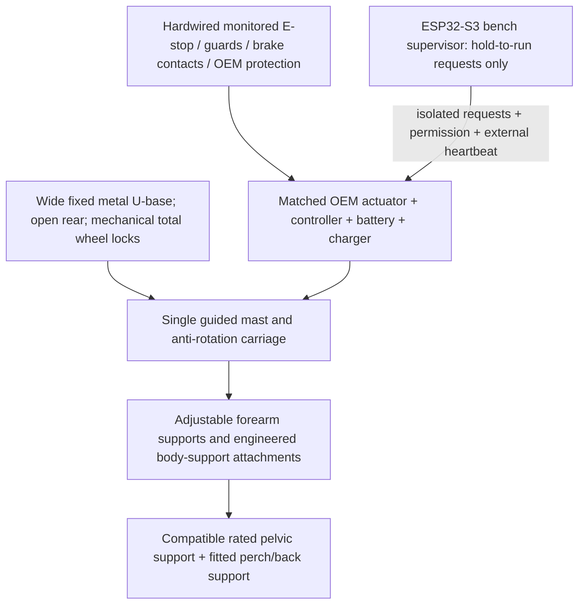

# P0 authoritative prototype specification

Revision: 15 October 2026. **Bench only. All dimensions and loads need engineering
release.** In case of disagreement, this document replaces archived drawings,
the original STEP model, and old browser animations.

## Intended scope and fit

Demonstrate assisted rise, controlled return to sitting, and a stationary perch
using instrumented dummy loads. Future users are adults able to participate in
standing with at least one leg, with sufficient trunk control and ability to
follow instructions. One-leg standing ability alone does not establish clinical
eligibility, upper-limb strength, endurance, balance, or permission to load an injury.

Provisional adjustable design-study envelope: 150–185 cm stature, 50–100 kg body
mass. This is not a safe working load or a claim to cover most humans. Test
different hip breadths, seated thigh clearance, lower-leg lengths, forearm lengths,
body proportions, footwear, and clothing, not only stature. Begin with a 75 kg
engineering dummy as one test case; passing it does not establish a 100 kg rating.

Adjust forearm height, support spacing, fore-aft reach, pelvic support size, and
perch height independently while unoccupied. Use mechanically retained settings
with scales and repeatable inspection marks. Do not telescope the base while loaded.
If the required adult range compromises stability or access, use multiple frame
sizes. Final supported population is determined by fit and structural test evidence.

## Selected architecture

| Subsystem | P0 decision and acceptance constraint |
| --- | --- |
| Base | Metal structural frame sized from the loaded stability envelope. No fixed 495 mm promise. No printed structural joints, carbon drilling, magnetic seat latch, or composite bonding dependency. |
| Wheels | Passive medical casters or an engineered equivalent. Lock wheel rotation and caster swivel for lift/perch. Two monitored brake groups cover all required locks; locking rear wheels alone is not assumed adequate. No electronics are needed to keep the wheel locks engaged. |
| Lift | One externally accessible guided carriage driven by one matched OEM lift system. The guide carries bending and torsion; actuator carries axial force. A normal actuator tube is not a structural mast. No dual-actuator synchronization, pulse homing, or actuator hidden inside a 26 mm bore. |
| Load retention | OEM safety nut/secondary retention plus an independently engineered positive mechanical perch lock. The column and load path must support the full fault load, including asymmetric loading. The sum of actuator thrust ratings is not a patient load rating. |
| Recovery | OEM-controlled emergency lowering operable after power/control failure, accessible with the frame loaded. Specify a safe procedure for unloading/removing the perch lock before lowering; never withdraw a loaded pin or bypass a brake. |
| Body support | Rated pelvic/thigh support with demonstrated compatibility to the engineered yoke. A loose waist belt is not a lifting sling or fall-arrest system. Do not assume that buying a commercial sling makes custom attachments safe. No axillary suspension. |
| Perch | Fitted supportive seat/hip interface with back/lateral support as needed, foot positioning, and a mechanical rest lock. Test sustained pressure and sliding. No hands-free reaching claim until supported reach trials pass. |
| Trajectory | Guide location and support geometry allow forward trunk motion and seat-off without trapping the knees. No universally optimal 12° column angle. Validate movement on an adjustable kinematic mock-up before freezing the mast geometry. |
| Electronics | ESP32-S3 provides secondary bench supervision. A separate safety circuit, external heartbeat watchdog, and OEM controls interrupt motion independently. No generic H-bridge is specified for a human-loaded lift. |

The mechanical perch lock is sensed by firmware and inhibits both directions.
Its retention and safe load-transfer/unlocking procedure must be independently
engineered. Firmware neither inserts the lock nor confirms the strength of its seat.

## Engineering fixture sequence (dummy loads only)

1. Reposition the empty device manually. Position a stable chair/mock worktop,
   remove trip hazards, engage all wheel and swivel locks, and verify their contacts.
2. With drive power isolated, install the dummy and compatible body support using
   the documented seated access route. No need to force a seat wing beneath a loaded
   pelvis. Inspect pins, support attachments, guards, and foot/knee clearance.
3. Restore the commissioned bench system. Check position and tilt, confirm an
   independent emergency-lowering route, release pendant buttons, then press/reset
   deliberately. Reset never starts motion.
4. A caregiver/operator holds UP continuously. Releasing it or opening any
   interlock removes requests. Verify guide loads, load sharing, and the forward
   lean path. Stop short of forced knee/hip extension.
5. At the fitted perch height, stop, engage the independent mechanical rest lock,
   and perform the engineered load-transfer procedure. Confirm static support
   without motor power. Use a cool mock worktop; do not begin with knives/hot pans.
6. Follow the engineered unloading procedure for the rest lock, then hold DOWN
   while guiding the dummy to the original seat. Release at any obstruction.
   Remove body support only after the dummy is fully supported by the chair.

## Kitchen and home access

Measure worktop height, knee/toe recess, reach distance, door clear opening,
turning space, chair/bed under-clearance and floor condition. Aim for the user to
work within a tested close reach envelope while the frame remains parked.
A narrow, high frame does not become stable because its battery is low.

Do not claim wet bathroom use: P0 is dry, level-floor only. Thresholds, ramps,
floor lifting, over-toilet transfers, stairs, occupied rolling, and autonomous
motion are excluded. A route that requires shrinking a loaded base fails P0's
home-fit gate; consider a different route, environment adaptation, or another aid.

## What has not been released

No production dimensions, rated patient load, approved sling/attachment pairing,
castor model, actuator SKU, lift speed, human stop distance, noise/IP rating,
finished mass, price, or build duration is established. Software fixture travel
and timeout values are placeholders; they do not define clinical motion settings.
See [validation](VALIDATION_PLAN.md) and [product research](../research/CURRENT_PRODUCTS_AND_DESIGN.md).
