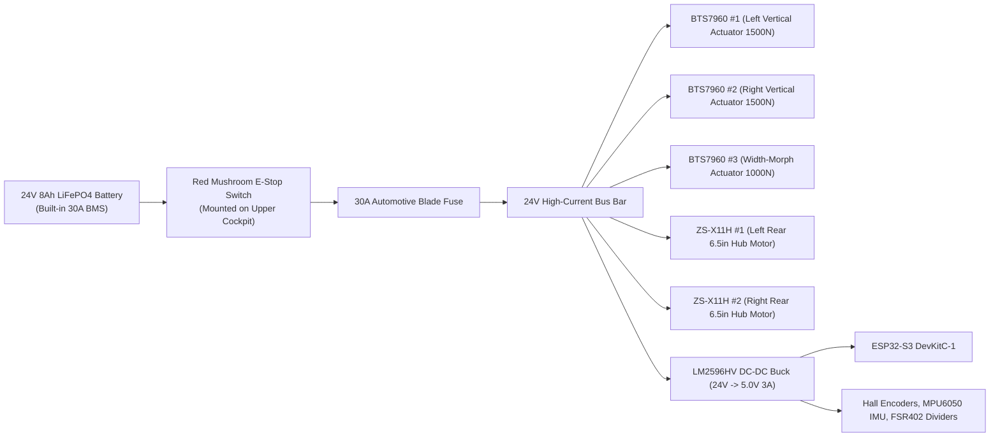

# ElderStep Pro (FreeStep v2) — Electrical Wiring & Mechanical Assembly Guide

## 1. Power Distribution Architecture

---

## 2. Complete ESP32 Pinout & Wiring Table

| Subsystem | Signal Name | ESP32 GPIO | Connected Hardware Pin | Notes |
| :--- | :--- | :---: | :--- | :--- |
| **Forearm Grip Sensors** | `PIN_FSR_LEFT` | `GPIO 34` | Left `FSR402` (`10kΩ` pull-down to GND) | Detects left forearm weight & push intent |
| **Forearm Grip Sensors** | `PIN_FSR_RIGHT` | `GPIO 35` | Right `FSR402` (`10kΩ` pull-down to GND) | Detects right forearm weight & push intent |
| **Vertical Lift (Left)** | `PIN_LIFT_L_RPWM` | `GPIO 25` | `BTS7960 #1` `RPWM` (Extend / Up) | Tie `R_EN` and `L_EN` to `5V` |
| **Vertical Lift (Left)** | `PIN_LIFT_L_LPWM` | `GPIO 26` | `BTS7960 #1` `LPWM` (Retract / Down) | |
| **Vertical Lift (Left)** | `PIN_LIFT_L_HALL` | `GPIO 18` | Left Actuator Hall Pulse Output | `10kΩ` pull-up to `3.3V` |
| **Vertical Lift (Right)** | `PIN_LIFT_R_RPWM` | `GPIO 27` | `BTS7960 #2` `RPWM` (Extend / Up) | Tie `R_EN` and `L_EN` to `5V` |
| **Vertical Lift (Right)** | `PIN_LIFT_R_LPWM` | `GPIO 14` | `BTS7960 #2` `LPWM` (Retract / Down) | |
| **Vertical Lift (Right)** | `PIN_LIFT_R_HALL` | `GPIO 19` | Right Actuator Hall Pulse Output | `10kΩ` pull-up to `3.3V` |
| **Width Morph ("Squeeze")** | `PIN_WIDTH_RPWM` | `GPIO 32` | `BTS7960 #3` `RPWM` (Widen to `620 mm`) | |
| **Width Morph ("Squeeze")** | `PIN_WIDTH_LPWM` | `GPIO 33` | `BTS7960 #3` `LPWM` (Narrow to `490 mm`) | |
| **Width Limit Switches** | `PIN_LIMIT_WIDE` | `GPIO 4` | Micro-switch NO (`COM` to GND) | Closed (`LOW`) when locked at `620 mm` |
| **Width Limit Switches** | `PIN_LIMIT_NARROW` | `GPIO 5` | Micro-switch NO (`COM` to GND) | Closed (`LOW`) when narrowed to `490 mm` |
| **Rear Hub Motors** | `PIN_HUB_BRAKE_EN` | `GPIO 23` | `ZS-X11H #1 & #2` `BRAKE` Pin | `HIGH` = Electromagnetic Lock Engaged |
| **Rear Hub Motors** | `PIN_HUB_THROTTLE_PWM` | `GPIO 13` | `ZS-X11H #1 & #2` `PWM` Input | Filtered or direct `1 kHz` PWM assist |
| **6-Axis IMU (`MPU6050`)** | `I2C_SDA` / `I2C_SCL` | `GPIO 8 / 9` | `MPU6050` `SDA` / `SCL` (`3.3V` logic) | Detects stumble spikes & $>12^\circ$ frame tilt |
| **Cockpit Buttons** | `PIN_BTN_LIFT_UP` | `GPIO 16` | Waterproof Rocker UP (`COM` to GND) | Active `LOW` (hold-to-run) |
| **Cockpit Buttons** | `PIN_BTN_LIFT_DOWN` | `GPIO 17` | Waterproof Rocker DOWN (`COM` to GND) | Active `LOW` (hold-to-run) |
| **Cockpit Buttons** | `PIN_BTN_SQUEEZE_MODE` | `GPIO 21` | Bathroom Squeeze Toggle (`COM` to GND) | Active `LOW` |
| **PWB Ankle Coach LED** | `PIN_LED_PWB_SAFE` | `GPIO 15` | Bi-Color Green/Red Status LED | Glows Green at target forearm offload |

---

## 3. Mechanical Fabrication & Assembly Checklist

### Step 1: Laser-Cut Brackets (`hardware/laser_cut/`)
1. Upload [`split_saddle_hinge_bracket.dxf`](laser_cut/split_saddle_hinge_bracket.dxf) (`Qty: 2`, `6 mm` 6061-T6 Aluminum or Mild Steel) and [`actuator_column_gusset.dxf`](laser_cut/actuator_column_gusset.dxf) (`Qty: 4`, `5 mm` Mild Steel) to **Robu.in Laser Cutting** or a local CNC fiber-laser shop.
2. Press-fit `10 mm` bronze flanged bushings into the main pivot holes of the `split_saddle_hinge_bracket` plates and attach a `Ø8 mm` spring index plunger to each wing so the split saddle clicks and locks solidly at both **$0^\circ$ (Open Walking Mode)** and **$90^\circ$ (Latched Sit-to-Stand / Kitchen Perch Mode)**.

### Step 2: Telescoping Sit-to-Stand Columns
1. Cut two outer square tubes (`40×40×2.5 mm`, length `550 mm`) and two inner square tubes (`35×35×2.5 mm`, length `550 mm`).
2. Adhere `1.5 mm` thick self-lubricating `UHMW-PE` (or PTFE) wear strips to the inside corners of the `40×40 mm` tube so the `35×35 mm` tube glides with zero rattle and zero metal-on-metal scraping.
3. Bolt the bottom clevis of each `1500N` linear actuator to [`actuator_column_gusset.dxf`](laser_cut/actuator_column_gusset.dxf) using an `M8` shoulder bolt, and the top rod eye to the upper cockpit crossbar.

### Step 3: 3D-Printed Ergonomic Mounts (`hardware/3d_print/`)
1. Print [`forearm_cockpit_mount.stl`](3d_print/forearm_cockpit_mount.stl) (`Qty: 2`, mirror for Left/Right) and [`ankle_knee_cradle_clamp.stl`](3d_print/ankle_knee_cradle_clamp.stl) (`Qty: 1`) in **PETG or ABS** with `4 perimeters` and `35% gyroid infill`.
2. Adhere the `FSR402` pressure sensor strip inside the recessed bottom channel of each `forearm_cockpit_mount` underneath the `20 mm` memory-foam forearm pad so downward forearm weight presses evenly onto the sensor.
